# TLS 1.3 explained, with animated diagrams

What really happens between your browser and your bank when you press Enter: HTTPS, SSL and TLS, symmetric and asymmetric keys, ECDHE, the TLS 1.3 handshake, the key schedule and certificates. Plus a hands-on lab and a TLS checklist for Microsoft environments.



## Read the article

[docs/article-en.md](docs/article-en.md)

## Diagrams

All diagrams are hand-built SVG files. The animated ones use plain CSS, with no JavaScript, and they respect the `prefers-reduced-motion` setting.

| # | Diagram | Animated |
|---|---|---|
| 1 | [HTTP vs HTTPS: what the network can read](images/01-http-vs-https.svg) | Yes |
| 2 | [HTTPS = HTTP inside TLS](images/02-https-layers.svg) | No |
| 3 | [The symmetric key distribution problem](images/03-symmetric-key-problem.svg) | Yes |
| 4 | [Public and private keys](images/04-asymmetric-keys.svg) | No |
| 5 | [ECDHE: agreeing on a secret without sending it](images/05-ecdhe-key-exchange.svg) | Yes |
| 6 | [The TLS 1.3 handshake](images/06-tls13-handshake.svg) | Yes |
| 7 | [The TLS 1.3 key schedule](images/07-tls13-key-schedule.svg) | No |
| 8 | [Certificate chain and browser checks](images/08-certificate-chain.svg) | No |

## Lab

Every script is read-only: it connects and reports, and changes nothing.

| Script | Runs on | What it shows |
|---|---|---|
| [`lab/openssl-lab.sh`](lab/openssl-lab.sh) | Linux, macOS, WSL, Git Bash | TLS version, cipher suite, ECDHE group, each handshake message, the certificate chain, legacy TLS refusal, and a key log for Wireshark |
| [`lab/Test-TlsEndpoint.ps1`](lab/Test-TlsEndpoint.ps1) | PowerShell 7 (Windows, Linux, macOS) | Negotiated version, cipher suite and certificate, and which TLS versions an endpoint accepts |
| [`lab/Get-SchannelTlsConfig.ps1`](lab/Get-SchannelTlsConfig.ps1) | Windows Server | Schannel protocol settings, .NET strong crypto settings and TLS 1.3 cipher suites |
| [`lab/Find-AzureLegacyTls.ps1`](lab/Find-AzureLegacyTls.ps1) | PowerShell with the Az modules | Storage accounts, Azure SQL servers and App Service apps whose minimum TLS version is below 1.2 |

Quick start:

```bash
./lab/openssl-lab.sh www.solisys.be
```

```powershell
./lab/Test-TlsEndpoint.ps1 -HostName www.solisys.be -TestAllProtocols
```

## Credits and references

- [The Illustrated TLS 1.3 Connection](https://tls13.xargs.org/), the byte-by-byte reference that inspired the key schedule diagram
- [RFC 8446](https://www.rfc-editor.org/rfc/rfc8446), updated by [RFC 9846](https://www.rfc-editor.org/rfc/rfc9846)
- The Microsoft Learn sources are listed at the end of the article.

## License

- Scripts: [MIT](LICENSE)
- Articles and diagrams: [CC BY 4.0](https://creativecommons.org/licenses/by/4.0/). You can reuse them with attribution to Olivier Lumeau, Solisys.
