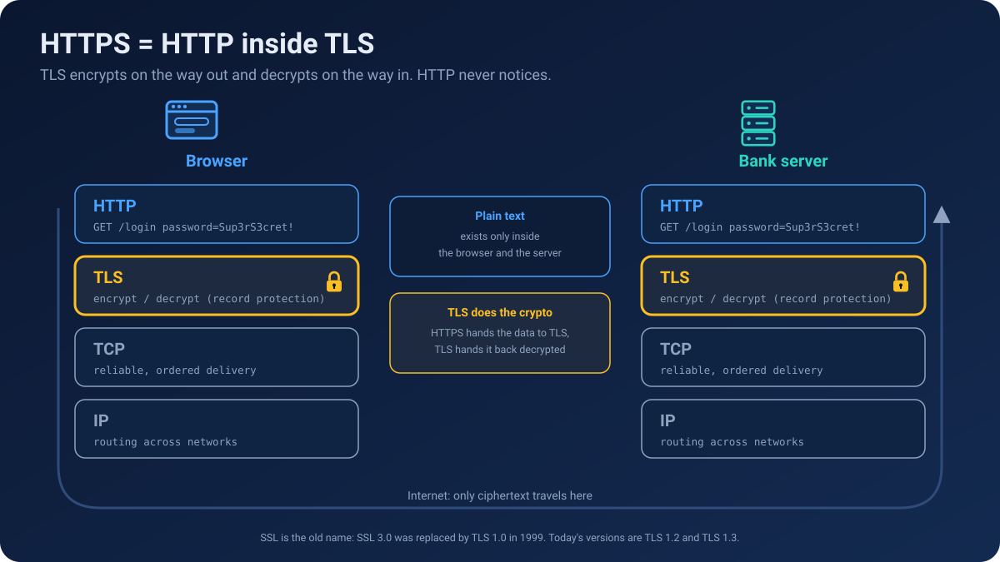
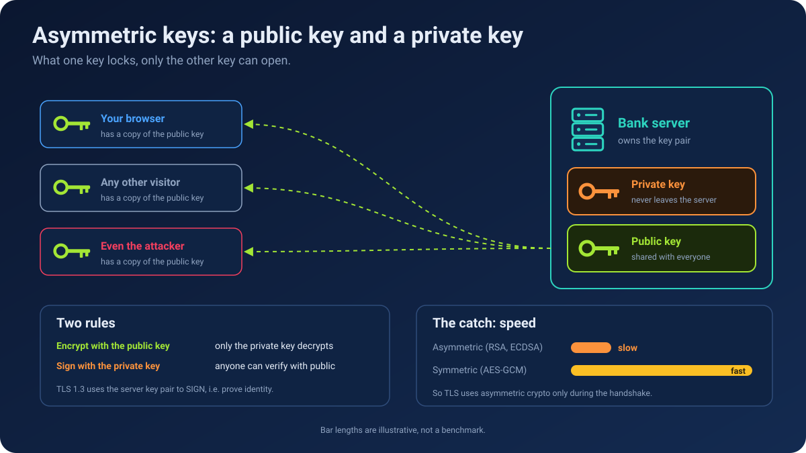
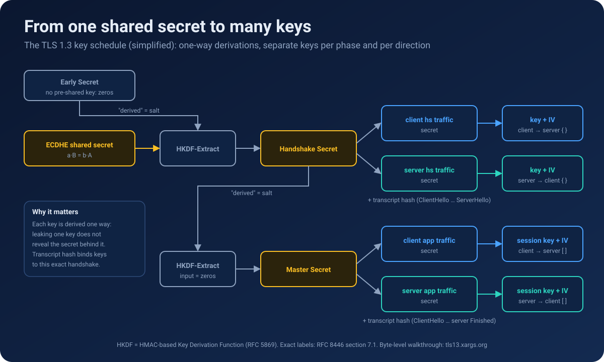
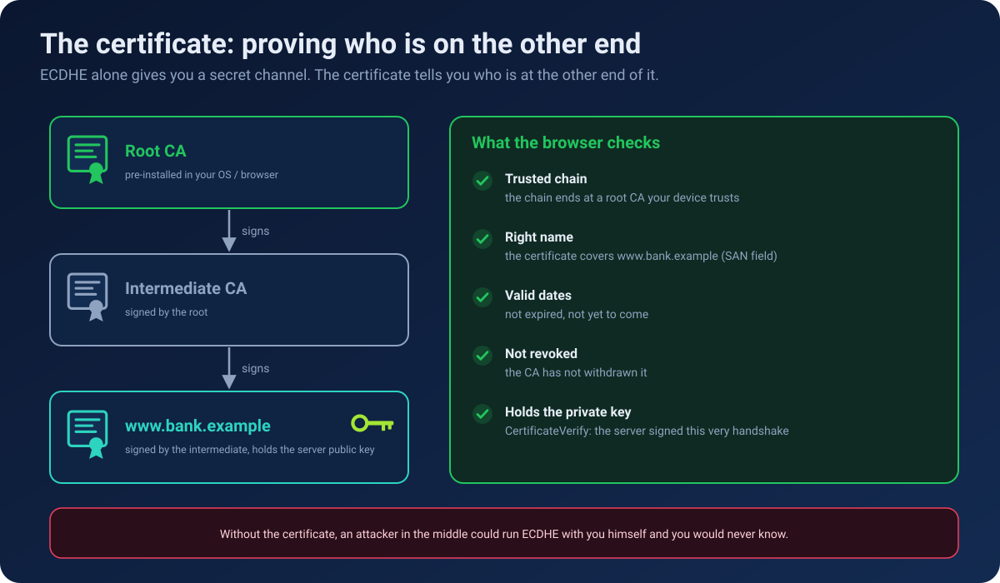

You type your customer ID and password on your bank's website and press Enter. A fraction of a second later, those characters reach a server you have never seen, after crossing your home router, your Internet provider and a dozen networks you don't control.

So why can't anyone on that path read your password? That's the job of TLS (Transport Layer Security). In this article, we follow that password step by step, with diagrams, and finish with a lab you can run yourself plus a checklist for Microsoft environments.

## 1. The problem: HTTP sends everything in plain text

With HTTP (HyperText Transfer Protocol), the request leaves the browser exactly as you typed it. Every device along the path can read it: the Wi-Fi access point, the Internet Service Provider (ISP), any network in between. That's why browsers mark HTTP pages as "Not secure".



The fix has to happen **before** the password leaves the browser. That's what HTTPS does.

## 2. HTTPS = HTTP inside TLS

HTTPS (HTTP Secure) isn't a new protocol. It's plain HTTP wrapped in a layer of encryption. And HTTP doesn't do the encryption itself: it hands that job to **TLS**.

- On the way out, TLS encrypts the HTTP data before it goes onto the network.
- On the way in, TLS decrypts it and hands the original request back to HTTP.
- HTTP never even knows the data was encrypted.



## 3. SSL or TLS?

SSL (Secure Sockets Layer) was the original protocol, created by Netscape in the mid 1990s. When its successor came out in 1999, it was renamed TLS 1.0. SSL 3.0 was formally deprecated in 2015 (RFC 7568), and TLS 1.0 and 1.1 followed in 2021 (RFC 8996). The current versions are **TLS 1.2** and **TLS 1.3**.

We still say "SSL certificate" out of habit. The certificate is the same, and the protocol is TLS.

## 4. Symmetric encryption: fast, but how do you share the key?

To encrypt, you need a key. The simplest approach is a single key, with one copy on each side: the browser encrypts with it, and the server decrypts with the same key. That's **symmetric encryption**, for example AES (Advanced Encryption Standard). It's extremely fast.

The problem is that one side has to create the key and send a copy to the other side. The only way to send it is the network, which is exactly the network we're trying to hide the password from. Send the key and the encrypted password on the same path, and an attacker just has to collect both.



## 5. Asymmetric encryption: a public key and a private key

Asymmetric encryption uses a key pair:

- Anything encrypted with the **public key** can only be decrypted with the matching **private key**.
- Anything signed with the **private key** can be verified by anyone who has the public key.

The server keeps its private key to itself and gives the public key to everyone, including attackers. That isn't a problem: the public key can't open anything on its own.



The catch is that asymmetric cryptography is much slower. Encrypting a whole web page, its images and scripts with it would make every page slow to load. So TLS uses it **only at the start of the connection**, and then switches to a fast symmetric key: the **session key**.

## 6. The part most explanations skip: TLS 1.3 never sends the session key

Many tutorials say the browser "encrypts the session key with the server's public key". That was true for the old RSA (Rivest-Shamir-Adleman) key exchange in TLS 1.2 and earlier. **TLS 1.3 removed it.**

TLS 1.3 uses **ECDHE** (Elliptic Curve Diffie-Hellman Ephemeral):

1. The browser picks a random private value `a` and computes a public value `A`.
2. The server does the same with `b` and `B`.
3. They exchange only `A` and `B`.
4. Each side combines its own private value with the other's public value. Both get the same secret `S`.



The secret `S` never travels on the network. An eavesdropper sees `A` and `B` but can't compute `S` from them. And because `a` and `b` are thrown away after each connection (that's the "Ephemeral"), stealing the server's private key next year won't decrypt traffic recorded today. That property is called **forward secrecy**, and every full TLS 1.3 handshake provides it.

So what is the server's key pair for in TLS 1.3? To **sign**, which proves it is really the bank (see section 9).

Worth knowing: hybrid post-quantum key exchange is already in production. The `X25519MLKEM768` group combines classic X25519 with ML-KEM-768 (Module-Lattice-based Key Encapsulation Mechanism) to resist "harvest now, decrypt later" attacks. Azure App Service, for example, negotiates it automatically with compatible TLS 1.3 clients.

## 7. The TLS 1.3 handshake, step by step

Here is the full exchange. Messages in `{ }` are already encrypted with the handshake keys, and `[ ]` means encrypted with the session keys.



1. **ClientHello**: a random value, the cipher suites the browser supports, its ECDHE public value (`key_share`) and the name of the site (SNI, Server Name Indication).
2. **ServerHello**: the server's random value, the chosen cipher suite (for example `TLS_AES_128_GCM_SHA256`) and its own `key_share`.
3. Both sides now compute the ECDHE secret and derive the **handshake keys**. From here on, everything is encrypted.
4. The server sends `{EncryptedExtensions}`, `{Certificate}`, `{CertificateVerify}` (a signature over the whole handshake, made with its private key) and `{Finished}` (a MAC, Message Authentication Code, over everything exchanged so far).
5. The browser checks the certificate, the signature and the Finished MAC, then sends its own `{Finished}`.
6. Both derive the **session keys**, and the encrypted application data starts flowing: your password, the pages, the images.

All of this takes **one round trip** (1-RTT, one Round-Trip Time), versus two for a full TLS 1.2 handshake. When the connection closes, the session keys are discarded.

Two details that surprise people:

- In TLS 1.3, the server certificate is encrypted. A passive observer can't see it, although the site name in the ClientHello is still visible unless ECH (Encrypted Client Hello) is used.
- In a capture, TLS 1.3 records claim to be TLS 1.2. That's intentional: too many middleboxes rejected unknown versions, so TLS 1.3 disguises itself and announces the real version in an extension.

## 8. From one secret to many keys: the key schedule

The ECDHE secret is never used directly as a key. TLS 1.3 feeds it into a chain of one-way derivations based on HKDF (HMAC-based Key Derivation Function, RFC 5869), where HMAC stands for Hash-based Message Authentication Code:



- **Separate keys per phase**: handshake keys protect the `{ }` messages, and application keys protect the `[ ]` data.
- **Separate keys per direction**: client to server and server to client never share a key.
- **Bound to the transcript**: each derivation mixes in a hash of the handshake messages, so the keys belong to this exact handshake and no other.

If you want to see every byte of this calculation, *The Illustrated TLS 1.3 Connection* (tls13.xargs.org) recomputes each key step by step with real values. It's the best resource I know on the subject.

## 9. The certificate: who is at the other end?

ECDHE gives you a private channel, but a private channel with whom? Without authentication, an attacker in the middle could simply run ECDHE with you, then another ECDHE with the bank, and relay everything. That's the role of the certificate.



The browser accepts the connection only if:

1. The certificate chain ends at a root CA (Certificate Authority) that your device already trusts.
2. The certificate covers the exact name you typed, through its SAN (Subject Alternative Name) field.
3. It's within its validity dates and hasn't been revoked.
4. **CertificateVerify** is valid. The server has signed this very handshake with the private key matching the certificate, which proves it really holds that key and isn't replaying someone else's certificate.

A practical note for enterprise readers: if you inspect the chain from your work laptop and the issuer is your company's proxy instead of a public CA, your traffic goes through **TLS inspection**. The proxy terminates TLS, reads it, then opens a new TLS session to the real site. That's legitimate on a managed device, but worth knowing.

## 10. Lab: see TLS for yourself

All scripts are in the GitHub repository [Solisys-Cloud/tls13-explained](https://github.com/Solisys-Cloud/tls13-explained).

**With openssl (Linux, macOS, WSL, Windows Subsystem for Linux, or Git Bash):**

```bash
# Version, cipher suite, ECDHE group and certificate
openssl s_client -connect www.solisys.be:443 -servername www.solisys.be -tls1_3 -brief </dev/null

# Each handshake message, as in the diagram
openssl s_client -connect www.solisys.be:443 -servername www.solisys.be -tls1_3 -msg </dev/null \
  | grep -E '^(>>>|<<<).*(Hello|Extensions|Certificate|Finished)'
```

The `-brief` output shows the protocol version, the cipher suite and a line like `Server Temp Key: X25519`. That's your ECDHE group.

**With PowerShell (Windows, Linux or macOS, PowerShell 7 recommended):**

```powershell
.\Test-TlsEndpoint.ps1 -HostName www.solisys.be
.\Test-TlsEndpoint.ps1 -HostName mystorageaccount.blob.core.windows.net -TestAllProtocols
```

**With Wireshark:** run `openssl s_client` with `-keylogfile keys.log`, or start Chrome, Edge or Firefox with the `SSLKEYLOGFILE` environment variable, then load that file in Wireshark (Preferences, Protocols, TLS). Look at the labels inside the file: `CLIENT_HANDSHAKE_TRAFFIC_SECRET`, `SERVER_TRAFFIC_SECRET_0`... These are exactly the secrets from the key schedule diagram. Delete the file afterwards, because anyone who has it can decrypt the captured session.

## 11. Microsoft checklist: TLS 1.2 is the floor

Microsoft has been retiring TLS 1.0 and 1.1 service by service. Where things stand today:

| Service | What to know | What to do |
|---|---|---|
| Azure Storage | Since February 3, 2026, TLS 1.0 and 1.1 are no longer supported. TLS 1.2 is the minimum for every storage account. | Find clients still on old versions. Set the minimum TLS version to 1.2 and audit it with the built-in Azure Policy definition. |
| Azure SQL Database and Managed Instance | The minimum TLS version can no longer be set below 1.2. TLS 1.0 and 1.1 support ended on August 31, 2025. | Check old drivers and connection strings. |
| Azure App Service, Functions, Logic Apps Standard | TLS 1.2 is the default minimum and TLS 1.3 is supported. On May 31, 2027, the platform will stop accepting TLS 1.0 and 1.1 whatever your settings. | Set **both** the site and SCM (Source Control Manager, the Kudu site) minimum TLS versions, **on every deployment slot**. |
| Microsoft Entra Connect | TLS 1.2 must be enforced in Schannel and in .NET Framework (`SchUseStrongCrypto`, `SystemDefaultTlsVersions`), followed by a restart. | `Get-ADSyncToolsTls12` to check, `Set-ADSyncToolsTls12` to apply. |
| Exchange Server | TLS 1.3 is supported from Exchange Server 2019 CU15 (Cumulative Update 15) on Windows Server 2022 or 2025, except for SMTP (Simple Mail Transfer Protocol) for now. | Run the Exchange HealthChecker script and follow Microsoft's TLS configuration guide. |

The repository includes two read-only scripts to start an audit: `Get-SchannelTlsConfig.ps1` for a Windows server and `Find-AzureLegacyTls.ps1` for an Azure tenant.

## In one sentence

HTTPS is HTTP inside TLS. TLS 1.3 uses ECDHE to agree on a secret that never travels, a certificate and a signature to prove who the server is, and fast symmetric session keys to protect your password and everything that follows.

## Sources

- [RFC 8446, The Transport Layer Security (TLS) Protocol Version 1.3](https://www.rfc-editor.org/rfc/rfc8446), updated by [RFC 9846](https://www.rfc-editor.org/rfc/rfc9846)
- [RFC 5869, HMAC-based Extract-and-Expand Key Derivation Function (HKDF)](https://www.rfc-editor.org/rfc/rfc5869)
- [RFC 8996, Deprecating TLS 1.0 and TLS 1.1](https://www.rfc-editor.org/rfc/rfc8996) and [RFC 7568, Deprecating SSL 3.0](https://www.rfc-editor.org/rfc/rfc7568)
- [The Illustrated TLS 1.3 Connection, every byte explained](https://tls13.xargs.org/)
- [Cloudflare, A detailed look at RFC 8446 (a.k.a. TLS 1.3)](https://blog.cloudflare.com/rfc-8446-aka-tls-1-3/)
- [Microsoft Learn, Migrate to TLS 1.2 for Azure Blob Storage](https://learn.microsoft.com/azure/storage/common/transport-layer-security-configure-migrate-to-tls2)
- [Microsoft Learn, Manage minimum TLS versions for Azure App Service](https://learn.microsoft.com/azure/app-service/tls-minimum-version)
- [Microsoft Learn, TLS/SSL in Azure App Service (TLS 1.3 and post-quantum key exchange)](https://learn.microsoft.com/azure/app-service/overview-tls)
- [Microsoft Learn, Minimal TLS version in Azure SQL Managed Instance](https://learn.microsoft.com/azure/azure-sql/managed-instance/minimal-tls-version-configure)
- [Microsoft Learn, TLS 1.2 enforcement for Microsoft Entra Connect](https://learn.microsoft.com/entra/identity/hybrid/connect/reference-connect-tls-enforcement)
- [Microsoft Learn, Exchange Server TLS configuration best practices](https://learn.microsoft.com/exchange/plan-and-deploy/post-installation-tasks/security-best-practices/exchange-tls-configuration)
